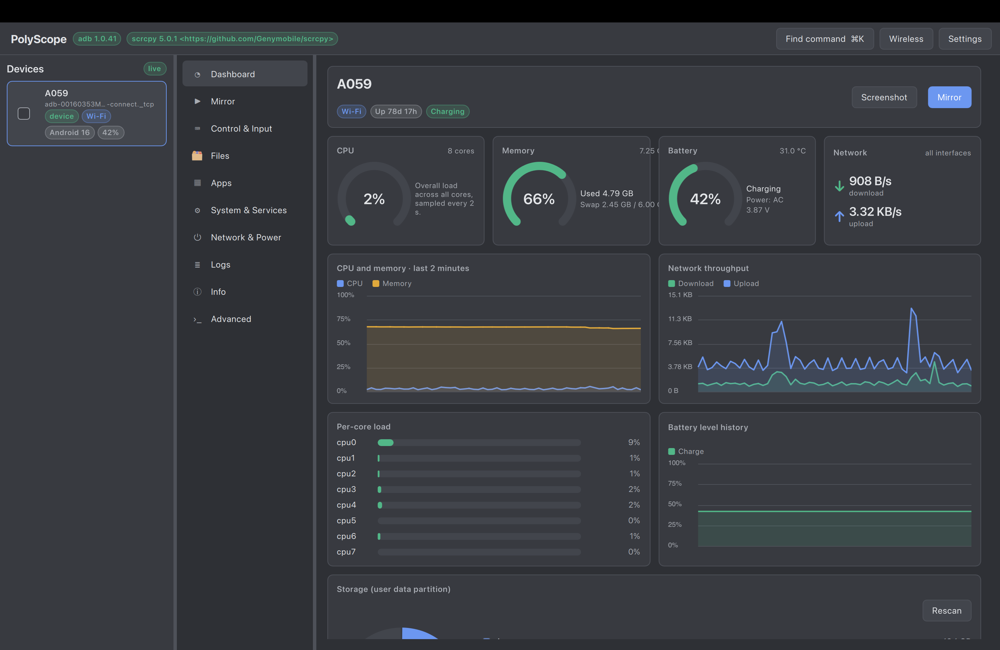

# PolyScope [](https://github.com/pyprism/PolyScope/actions/workflows/ci.yml)

Open source desktop app (Qt 6 + QML) to **display and control Android devices** on Linux, macOS and
Windows. It is a graphical wrapper around two tools you install yourself:

- [`adb`](https://developer.android.com/tools/adb) – Android Debug Bridge
- [`scrcpy`](https://github.com/Genymobile/scrcpy) – screen mirroring and control

PolyScope **does not bundle either binary**. It finds them on your `PATH` (and in common install
locations), or you can point it at them in Settings.

## Screenshots



## Features

- Multiple devices at once (USB and Wi-Fi), live device list with model, Android version and battery.
- **Wireless (Wi-Fi) ADB**: pair, connect, switch a USB device to Wi-Fi, mDNS discovery.
  > ADB has no Bluetooth transport. "Wireless debugging" runs over Wi-Fi; Bluetooth is not used.
- **scrcpy**: one managed session per device with every scrcpy option (video, audio, camera,
  virtual display, input, window, recording, OTG), presets, per-device saved options, and a live
  command-line preview. scrcpy opens its own window.
- **ADB toolbox**: a catalogue of 140+ commands covering the whole `adb` surface (server,
  connection, port forwarding, files, apps, services, system, input, display, network, power, logs,
  recovery, privileged), file browser, package manager, services browser, logcat, interactive
  shell, screenshot, device overview, and a raw command runner.
- **Dashboard**: live CPU, memory, battery and network gauges and history charts, per-core load,
  storage breakdown (donut by category, largest apps with a per-app drill-down, partitions), battery temperature/voltage and top processes you can stop, drawn natively.
- Light and soft-dark themes (follows the OS by default).

> Status: the full interface is implemented and checked on macOS against a real device over wireless
> adb. Linux and Windows builds are untested until CI runs.

### Using it

- Pick a device in the sidebar; tick several to run catalogue commands on all of them (batch).
- `Ctrl/Cmd+K` finds any adb command and jumps to it.
- **Files**: double-click to open folders; click a row for pull / rename / delete. Push with the
  button, or drop files onto the window while on the Files page. They land in the folder currently shown.
- **Apps**: choose APK(s) with *Install APK…*; several APKs are installed as one split package.
  scrcpy itself also accepts APKs and files dropped on its own window (APK installs, others push to `/sdcard/Download/`).

## Install the prerequisites

| | adb | scrcpy |
|---|---|---|
| macOS | `brew install android-platform-tools scrcpy` | `brew install scrcpy` |
| Debian/Ubuntu | `sudo apt install adb scrcpy` | included above |
| Fedora | `sudo dnf install android-tools scrcpy` | included above |
| Arch | `sudo pacman -S android-tools scrcpy` | included above |
| Windows | `winget install Google.PlatformTools Genymobile.scrcpy` (or `scoop install adb scrcpy`) | included above |

PolyScope's option list follows scrcpy 5.0; flags your scrcpy version does not know will make it refuse to start (use the live command preview to check).

## Prepare the phone

1. Settings → About phone → tap **Build number** 7 times to enable Developer options.
2. Developer options → enable **USB debugging**.
3. Connect by USB and accept the "Allow USB debugging?" prompt on the phone.
4. For Wi-Fi: enable **Wireless debugging** (Android 11+), then use *Pair device with pairing code*
   in PolyScope, or connect by USB and use *USB → Wi-Fi*.
5. For keyboard/mouse control via scrcpy you may also need *USB debugging (Security settings)* on
   some vendors (Xiaomi/MIUI).

## Build and run

Requirements: Qt ≥ 6.8 (Core, Gui, Qml, Quick, QuickControls2, Network, Svg, Test), CMake ≥ 3.21,
a C++20 compiler.

```bash
./run.sh            # configure + build (Debug) + launch
./run.sh --test     # build + run unit tests
./run.sh --clean    # wipe build/ first
```

`run.sh` finds Qt through `qmake6`; set `QT_PREFIX=/path/to/Qt/6.x/gcc_64` to override. It uses Ninja
when installed, otherwise the default CMake generator.

Manual build:

```bash
cmake -S . -B build -DCMAKE_PREFIX_PATH=/path/to/Qt -DCMAKE_BUILD_TYPE=Release
cmake --build build --parallel
ctest --test-dir build --output-on-failure
```

## Unsigned builds

Release builds are **not code-signed**.

- **macOS**: Gatekeeper blocks the first launch. Right-click → *Open*, or remove the quarantine flag:
  `xattr -dr com.apple.quarantine /Applications/PolyScope.app`
  If macOS says the app is *damaged*, the quarantine flag is the cause; `xattr -cr /Applications/PolyScope.app` fixes it.
- **Windows**: SmartScreen shows "Windows protected your PC". Click *More info* → *Run anyway*.
- **Linux**: ships as an AppImage; no signing involved. Mark it executable (`chmod +x PolyScope-Linux-x86_64.AppImage`) and run it.

## License

MIT, see [LICENSE](LICENSE).

## Credits

App icon: <a href="https://www.flaticon.com/free-icon/tool-box_2276313" title="toolbox icons">Toolbox icons created by Magnific - Flaticon</a>
